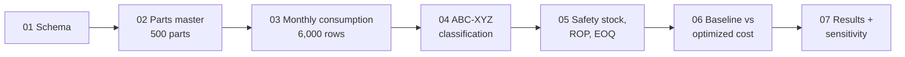

# MRO Spare Parts Inventory Optimization (SQL)


An end-to-end inventory optimization model built in **pure SQL** for 500 simulated MRO (Maintenance, Repair, Operations) spare parts. It segments parts with **ABC-XYZ analysis**, sets **safety stock, reorder points and EOQ** per part, and measures the saving against a traditional static-buffer policy.

> [!NOTE]
> All data is **synthetic**, generated in `sql/02` and `sql/03`. The results show how the method behaves, not the performance of a real plant.

## Headline results

| Metric | Static baseline | Optimized | Change |
|---|---|---|---|
| Annual holding cost | $1,033,380 | **$790,633** | **-23.5%** |
| Holding + ordering cost | $1,222,915 | **$998,129** | **-18.4%** |
| Blended cycle service level | 96.96% | **98.78%** | **+1.8 pts** |

Baseline: 45-day safety buffer on every part, ordering two months at a time. The optimized policy is **cheaper and better protected**, so the saving does not come from protecting less.

## Contents

- [Pipeline](#pipeline)
- [Project structure](#project-structure)
- [Data model](#data-model)
- [Method](#method)
- [Results in detail](#results-in-detail)
- [Sensitivity analysis](#sensitivity-analysis)
- [Excel validation](#excel-validation)
- [How to run](#how-to-run)
- [Limitations](#limitations)

## Pipeline



## Project structure

```
mro-inventory-optimization-sql/
├── data/
│   └── mro.db                    SQLite database (reproduces all results)
├── sql/
│   ├── 00_check_setup.sql        Verifies CTE, window and math function support
│   ├── 01_schema.sql             Tables and foreign key
│   ├── 02_parts_master.sql       500 parts with skewed unit costs
│   ├── 03_monthly_consumption.sql  12 months of steady, variable and lumpy demand
│   ├── 04_abc_xyz.sql            ABC and XYZ classification
│   ├── 05_inventory_policy.sql   Safety stock, reorder point, EOQ
│   ├── 06_cost_comparison.sql    Baseline vs optimized cost and service level
│   └── 07_results.sql            Report and sensitivity grid
└── output/
    ├── policy_comparison.csv     Per-part results
    ├── part_classification.csv   Per-part ABC-XYZ classes
    ├── mro0003_months.csv        Sample part used for validation
    └── mro_validation.xlsx       Independent Excel recalculation
```

## Data model

```sql
CREATE TABLE parts_master (
    part_id            TEXT PRIMARY KEY,
    part_name          TEXT    NOT NULL,
    unit_cost          REAL    NOT NULL,
    lead_time_days     INTEGER NOT NULL,
    lead_time_std_dev  REAL    NOT NULL,
    ordering_cost      REAL    NOT NULL
);

CREATE TABLE monthly_consumption (
    part_id       TEXT    NOT NULL,
    month_name    TEXT    NOT NULL,
    consumed_qty  INTEGER NOT NULL,
    PRIMARY KEY (part_id, month_name),
    FOREIGN KEY (part_id) REFERENCES parts_master (part_id)
);
```

500 parts × 12 months = 6,000 consumption rows. Demand is generated with three hidden patterns (50% steady, 30% moderate, 20% lumpy), and the classification step has to rediscover them from the numbers alone.

## Method

| Step | Definition |
|---|---|
| **ABC** | Rank parts by annual spend. Cumulative spend decides the class: A up to 80%, B up to 95%, C the rest |
| **XYZ** | Coefficient of variation of monthly demand: X ≤ 0.5, Y ≤ 1.0, Z > 1.0 |
| **Safety stock** | `Z × √(L·σd² + d²·σL²)`, combining demand and lead-time variability |
| **Service targets** | A 99% (Z = 2.33), B 97% (Z = 1.88), C 95% (Z = 1.65) |
| **Reorder point** | `d × L + safety stock` |
| **EOQ** | `√(2·D·S / (h·C))` with a 20% annual holding rate |
| **Holding cost** | `h × C × (Q/2 + safety stock)` |

SQLite has no `STDDEV` or inverse-normal function, so standard deviation is computed as `SQRT(AVG(x²) − AVG(x)²)` and the three Z-scores are stored in a lookup table.

> [!TIP]
> The correct Z-score for a 97% service level is **1.88**. The commonly quoted 1.96 is the 97.5th percentile (the two-sided 95% value).

**ABC classification (`sql/04_abc_xyz.sql`)**

```sql
-- cum_pct - spend_pct is the running total BEFORE this part,
-- so the part that crosses 80% still belongs in class A
CASE WHEN cum_pct - spend_pct < 0.80 THEN 'A'
     WHEN cum_pct - spend_pct < 0.95 THEN 'B'
     ELSE 'C' END AS abc_class
```

**Safety stock, reorder point and EOQ (`sql/05_inventory_policy.sql`)**

```sql
z_score * SQRT( lead_time_days * daily_std * daily_std
              + daily_demand * daily_demand
                * lead_time_std_dev * lead_time_std_dev ) AS ss_raw

CEIL(ss_raw)                                    AS safety_stock,
CEIL(daily_demand * lead_time_days + ss_raw)    AS rop,
CEIL(SQRT(2 * annual_qty * ordering_cost
          / (holding_rate * unit_cost)))        AS eoq
```

## Results in detail

### ABC-XYZ segmentation

| Class | Parts | % of parts | % of spend |
|---|---|---|---|
| A | 133 | 26.6% | 80.2% |
| B | 133 | 26.6% | 14.9% |
| C | 234 | 46.8% | 5.0% |

| | X (steady) | Y (moderate) | Z (erratic) | Total |
|---|---|---|---|---|
| **A** | 87 | 22 | 24 | 133 |
| **B** | 73 | 30 | 30 | 133 |
| **C** | 151 | 41 | 42 | 234 |
| **Total** | 311 | 93 | 96 | 500 |

Safety stock cover rises with variability: **20.3 days** for X, **35.5 days** for Y, **93.7 days** for Z.

### Holding cost by class

| Class | Baseline | Optimized | Change |
|---|---|---|---|
| A | $828,591 | $591,435 | **-28.6%** |
| B | $153,508 | $136,094 | **-11.3%** |
| C | $51,281 | $63,104 | **+23.1%** |

Most of the saving comes from class A, where expensive parts were over-buffered. Class C costs slightly more because cheap, erratic parts now receive the protection they were missing.

### Service level by class

| Class | Target | Optimized | Baseline |
|---|---|---|---|
| A | 99.0% | 99.2% | 97.5% |
| B | 97.0% | 97.7% | 96.2% |
| C | 95.0% | 96.6% | 96.5% |

The spend-weighted target is **98.5%**. The optimized policy achieves **98.78%** and the baseline **96.96%**. These are cycle service levels (probability of no stockout per replenishment cycle), not fill rates.

## Sensitivity analysis

The 45-day / 2-month baseline is an assumption, so the saving was recalculated across other baselines:

| Buffer days | Order months | Holding saving | Total saving |
|---|---|---|---|
| 30 | 1 | -27.6% | 0.0% |
| 30 | 2 | 4.5% | 1.9% |
| 30 | 3 | 23.7% | 14.1% |
| 45 | 1 | 4.2% | 17.1% |
| **45** | **2** | **23.5%** | **18.4%** |
| 45 | 3 | 36.3% | 27.0% |
| 60 | 1 | 23.3% | 29.2% |
| 60 | 2 | 36.2% | 30.1% |
| 60 | 3 | 45.4% | 36.6% |
| 90 | 1 | 45.2% | 45.2% |
| 90 | 2 | 52.1% | 45.7% |
| 90 | 3 | 57.5% | 49.7% |

The saving depends on how generous the baseline is. Shorter baselines also protect less, so the "cheaper and better protected" claim is verified at the 45-day / 2-month baseline only.

## Excel validation

Part **MRO-0003** (class A, X) was recomputed independently in Excel from its 12 monthly values, using `STDEV.P`, and matched the SQL output exactly. The workbook is in [`output/mro_validation.xlsx`](output/mro_validation.xlsx).

| Quantity | Excel | SQL |
|---|---|---|
| Annual demand | 420 | 420 |
| Mean monthly demand | 35 | 35 |
| CV | 0.47 | 0.47 |
| Safety stock | 48 | 48 |
| Reorder point | 89 | 89 |
| EOQ | 17 | 17 |

Sanity checks on all 500 parts: no negative safety stock, no reorder point below safety stock, and an ABC split of 80.2 / 14.9 / 5.0.

## How to run

Requires SQLite 3.35 or newer (window and math functions).

```bash
git clone https://github.com/Amanrathi-Git/mro-inventory-optimization-sql.git
cd mro-inventory-optimization-sql

sqlite3 data/mro.db < sql/04_abc_xyz.sql
sqlite3 data/mro.db < sql/05_inventory_policy.sql
sqlite3 data/mro.db < sql/06_cost_comparison.sql
sqlite3 data/mro.db < sql/07_results.sql
```

> [!WARNING]
> `data/mro.db` is included so the numbers above reproduce exactly. Re-running `sql/02` or `sql/03` generates a new random dataset and all results will change.

## Limitations

- Synthetic data; real demand would differ.
- The baseline policy is an assumption (see the sensitivity analysis).
- Safety stock assumes roughly normal demand, which fits lumpy Z items poorly. A Poisson or bootstrap method would suit them better.
- Daily demand variance is scaled from monthly variance, assuming independent days.
- Service level is a cycle service level. Stockout cost is not modeled, so service targets are chosen rather than cost-optimized.
- Parts with zero annual demand are classed Z by convention.

## Author

**Aman Rathi** · [GitHub](https://github.com/Amanrathi-Git)
